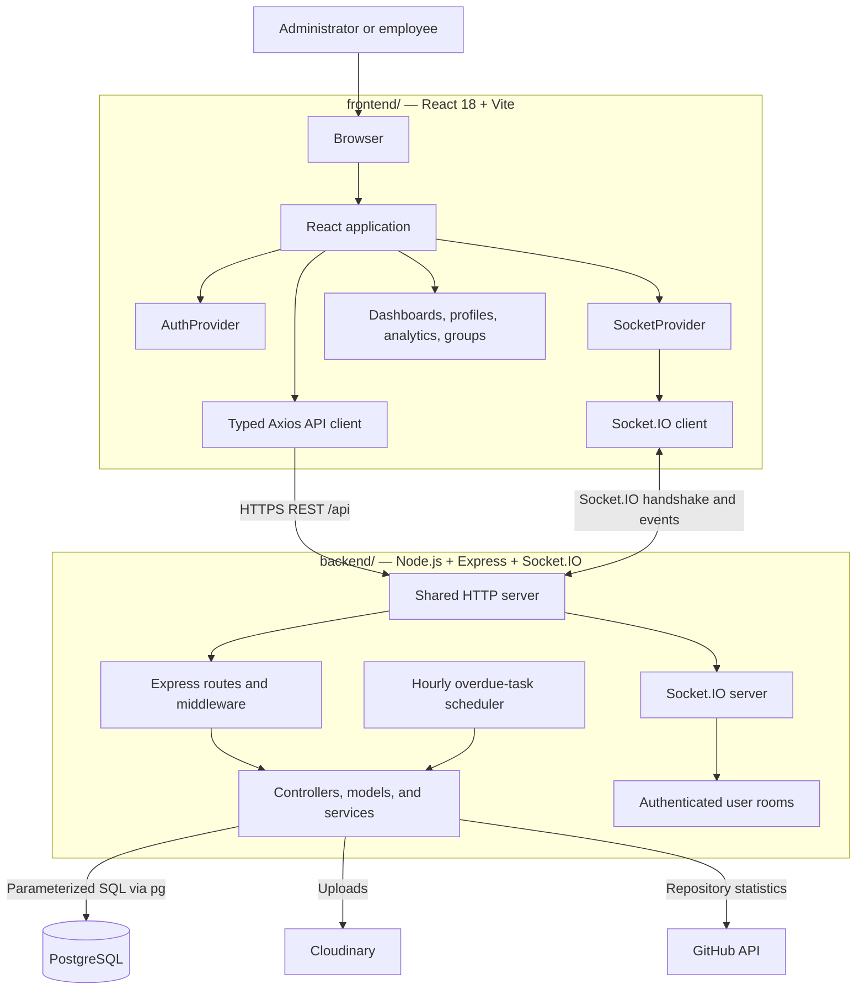
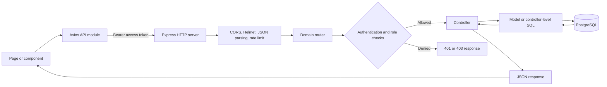
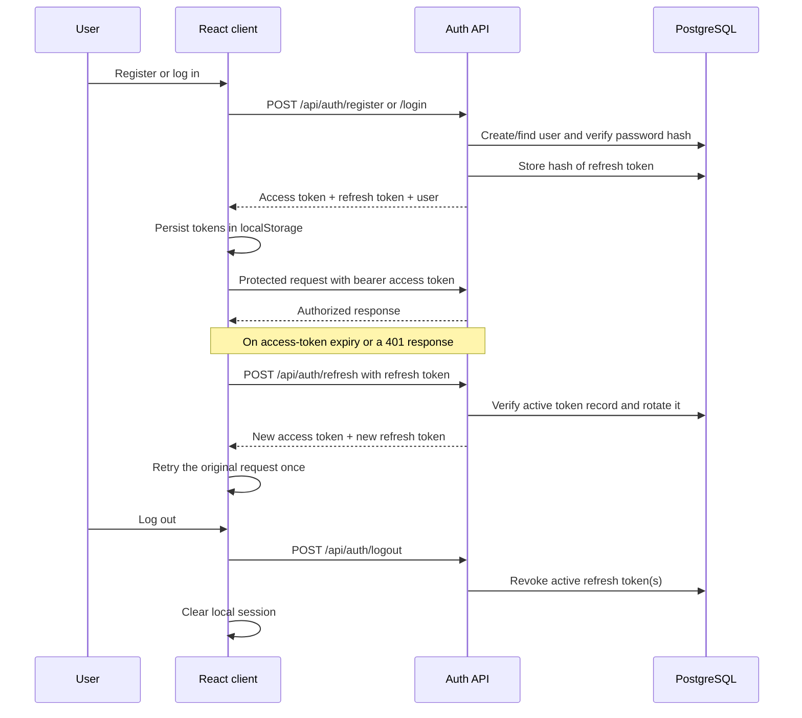
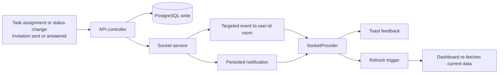
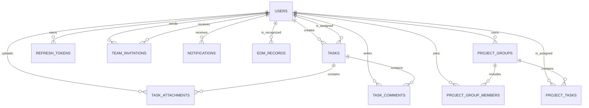

# WorkWave

WorkWave is a full-stack employee and team-management application. It gives administrators a place to build teams, assign and monitor work, and review performance, while employees can manage their workload, collaborate on tasks, and follow project progress in real time.

WorkWave pairs the TypeScript application in [`frontend/`](frontend/) with the Express API in [`backend/`](backend/).

## Highlights

- Role-based accounts for administrators and employees
- Team invitations with acceptance and rejection workflows
- Individual task assignment with priorities, due dates, attachments, comments, and status tracking
- In-app notifications and live task/invitation updates over Socket.IO
- Profile management and Cloudinary-hosted avatar and task-file uploads
- Employee performance views, team analytics, a leaderboard, and Employee of the Month history
- Project groups with member progress, group tasks, and optional GitHub repository statistics
- An hourly background job that flags overdue individual tasks

## Product preview

| Landing experience | Employee workspace |
| --- | --- |
|  |  |

## Live deployment

Visit the deployed application at [workwave-six.vercel.app](https://workwave-six.vercel.app/).

## Architecture

WorkWave is a single-page application served separately from a Node.js API. REST handles durable application operations; Socket.IO pushes live events to authenticated users. PostgreSQL is the system of record, while Cloudinary and GitHub provide focused external capabilities.

### System topology



### HTTP request path



The frontend centralizes request authentication and retries one failed protected request after a token refresh. Backend routes group the product by authentication, tasks, invitations, notifications, employee insights, leaderboard, project groups, and admin analytics.

### Authentication and session lifecycle



### Real-time updates and notifications



Sockets authenticate with the current access token, join a personal room, and reconnect with a refreshed token after token expiry. The server emits task and invitation events to the people involved; notifications are persisted so they remain available through the notification API.

### Core domain relationships



### Product modules

| Module | Frontend experience | Backend responsibilities | Primary data |
| --- | --- | --- | --- |
| Accounts and profiles | Login, signup, profile editing, avatar upload | Authentication, token refresh/rotation, profile updates, uploads | `users`, `refresh_tokens` |
| Team management | Invite employees by email and view team membership | Invitation rules and team queries | `team_invitations`, `users` |
| Individual tasks | Create, assign, accept, complete, fail, comment, and attach files | Task lifecycle, participant access, file handling, event emission | `tasks`, `task_comments`, `task_attachments` |
| Notifications | Notification panel, unread state, live toasts | Persist, deliver, and mark notifications read | `notifications` |
| Insights and recognition | Employee profile statistics, analytics, leaderboard, EOM history | Aggregate task metrics and archive recognition | `tasks`, `eom_records` |
| Project groups | Group workspace, member progress, group tasks, repository charts | Group membership, project-task tracking, GitHub statistics | `project_groups`, `project_group_members`, `project_tasks` |
| Background work | Overdue indicators in task views | Hourly sweep of unfinished overdue individual tasks | `tasks` |

## Technology

| Area | Tools |
| --- | --- |
| Frontend | React 18, Vite, TypeScript, React Router, Axios, Socket.IO Client |
| UI and data visualization | CSS Modules, GSAP, Recharts, React Toastify |
| Backend | Node.js, Express 5, TypeScript, Socket.IO |
| Data and security | PostgreSQL (`pg`), JWT, bcryptjs, Helmet, CORS, rate limiting |
| Integrations | Cloudinary, GitHub API, node-cron |

> Styling is implemented with CSS Modules and global CSS. Tailwind CSS is not part of the active application.

## Repository layout

```text
.
|-- backend/          Express API, PostgreSQL access, Socket.IO, and background jobs
|-- frontend/         React/Vite single-page application
`-- docs/audit/       Implementation-level architecture, API, schema, and configuration notes
```

## Prerequisites

- Node.js and npm (a current LTS release is recommended)
- PostgreSQL database
- Cloudinary account for avatar and attachment uploads
- Optional: GitHub personal access token for higher GitHub API limits when using group repository statistics

## Local development

### 1. Install dependencies

```bash
cd backend
npm ci

cd ../frontend
npm ci
```

`npm install` is also suitable when you intentionally need to update the lockfile.

### 2. Configure the backend

Create `backend/.env`:

```env
PORT=5000
DATABASE_URL=postgresql://<user>:<password>@<host>:<port>/<database>
JWT_SECRET=<long-random-access-token-secret>
JWT_REFRESH_SECRET=<different-long-random-refresh-token-secret>

# Required for avatar and task-attachment uploads
CLOUDINARY_CLOUD_NAME=<cloud-name>
CLOUDINARY_API_KEY=<api-key>
CLOUDINARY_API_SECRET=<api-secret>

# Optional; GitHub calls work without it but are rate-limited more aggressively
GITHUB_PERSONAL_ACCESS_TOKEN=<token>

NODE_ENV=development
```

For a managed PostgreSQL provider, use its TLS-enabled connection string. Local PostgreSQL connections to `localhost` and `127.0.0.1` are automatically configured without TLS by the API.

### 3. Prepare the database

The current migration is additive: it creates the feature tables and extends the existing core schema. It expects `users` and `tasks` to exist already, so it does **not** bootstrap an empty database by itself. The full, code-derived schema notes are in [`docs/audit/03-DATABASE-SCHEMA.md`](docs/audit/03-DATABASE-SCHEMA.md).

After the core tables are available, run:

```bash
cd backend
npx ts-node src/config/migration.ts
```

This migration is idempotent and may be re-run. It also ensures the `refresh_tokens` table and its indexes exist.

### 4. Configure the frontend

Create `frontend/.env`:

```env
VITE_API_URL=http://localhost:5000/api
```

`VITE_API_URL` is the REST base URL. The Socket.IO client derives the server origin from it automatically, so no second local variable is required.

### 5. Start the services

In separate terminals:

```bash
# terminal 1
cd backend
npm run dev
```

```bash
# terminal 2
cd frontend
npm run dev
```

Open the URL printed by Vite (normally `http://localhost:5173`). The API health endpoint is available at `http://localhost:5000/health`.

## Quality checks

```bash
# frontend
cd frontend
npm run lint
npm run build

# backend
cd ../backend
npm run build
```

There is currently no automated test suite or `test` script. The commands above provide the available lint and compile/build checks.

## API at a glance

All application endpoints are rooted at `/api`; authenticated endpoints expect a bearer access token. Responses generally use `success`, `data`, and `error` fields.

| Area | Base path | Purpose |
| --- | --- | --- |
| Authentication and profile | `/api/auth` | Registration, login, token refresh, session logout, profile and avatar updates |
| Tasks | `/api/tasks` | Individual tasks, status changes, attachments, and comments |
| Teams | `/api/invitations` | Invitations, accepted team members, and pending invitations |
| Notifications | `/api/notifications` | Notification feed, unread count, and read state |
| Insights | `/api/employees`, `/api/leaderboard`, `/api/admin` | Employee statistics, leaderboard/EOM records, and admin analytics |
| Project groups | `/api/groups` | Groups, group tasks, progress, and GitHub statistics |

For the route-by-route contract and authorization behavior, see [`docs/audit/02-API-REFERENCE.md`](docs/audit/02-API-REFERENCE.md).

## Deployment notes

- The frontend includes a Vercel SPA rewrite and security headers (including a Content-Security-Policy) in [`frontend/vercel.json`](frontend/vercel.json).
- The CSP's `connect-src` allows only the deployed API origin. If the backend URL changes, update it in `vercel.json` as well as `VITE_API_URL`, or the browser will block API and socket calls.
- Build the API with `npm run build` in `backend/`, then run `npm start` to serve `dist/index.js`.
- Set the frontend's `VITE_API_URL` to the deployed API URL including `/api`.
- Before deploying a frontend to a new origin, add that origin to the backend CORS allowlist in [`backend/src/index.ts`](backend/src/index.ts).
- After deploying schema-related changes, re-run `npx ts-node src/config/migration.ts` against the production database (it is idempotent).
- Provision PostgreSQL and Cloudinary credentials in the deployment environment; never expose backend secrets in Vite variables or commit `.env` files.

## Additional documentation

The [`docs/audit/`](docs/audit/) directory is the repository's implementation audit. It covers the current architecture, database schema, authentication flow, real-time events, frontend structure, configuration, and known gaps. It was written in July 2026; [`docs/audit/00-STATUS.md`](docs/audit/00-STATUS.md) lists what has been fixed since. It is the best reference when extending or operating the application.

## License

No license file is currently included in this repository. Add one before distributing or reusing the project outside its intended scope.
